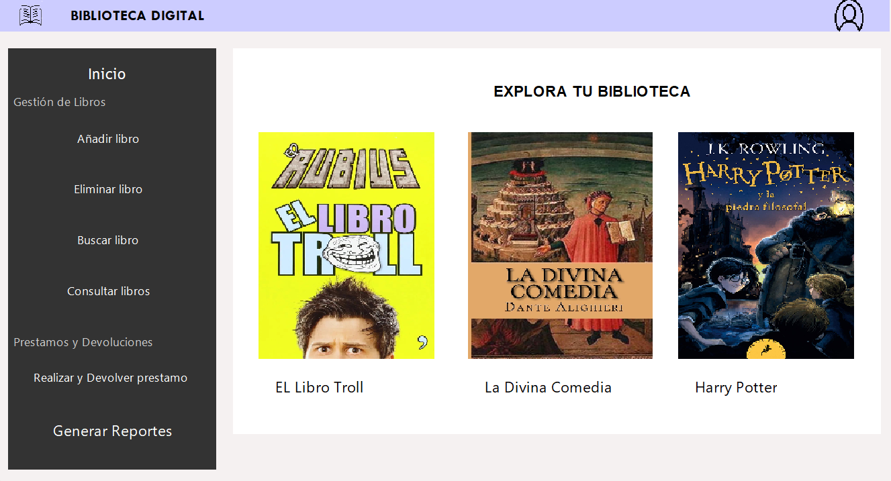
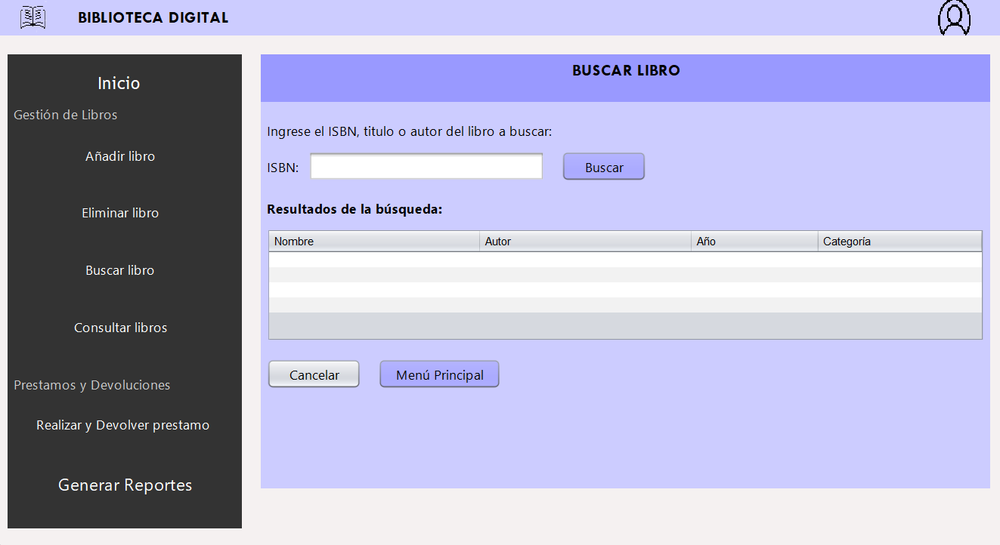

# Gestor de Biblioteca

Aplicación de escritorio en Java para gestionar el catálogo de una biblioteca, buscar libros y controlar préstamos y devoluciones.

## Funcionalidades

- Añadir y eliminar libros
- Búsqueda por ISBN, título o autor
- Catálogo de libros
- Préstamos y devoluciones
- Generación de reportes

## Tecnologías

- Java
- NetBeans

## Cómo ejecutarlo

1. Instala el JDK 17 o superior.
2. Clona el repositorio:
   `git clone https://github.com/GabrielDesales/gestor-biblioteca.git`
3. Abre el proyecto en NetBeans y ejecuta la clase principal.

## Capturas

## Autor

Gabriel Guerrero Desales
